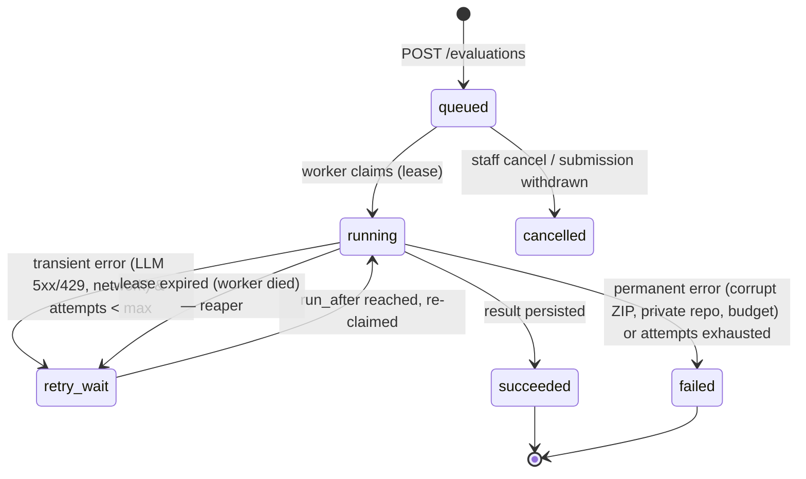
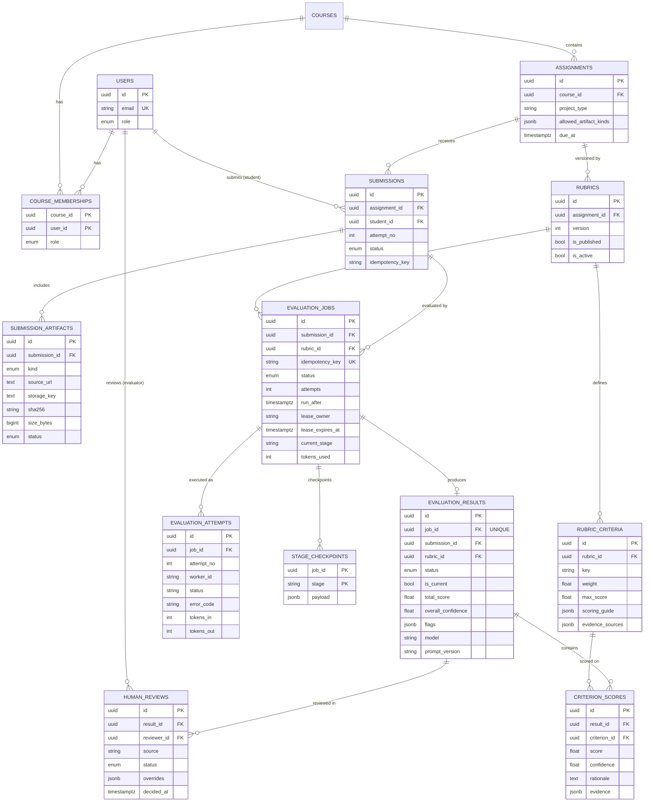

# AI-Powered Project Evaluation Platform — Backend Architecture

**SDE-II Backend Architecture Assignment · AlmaBetter**
Author: Rahul Dabola · Companion proof-of-concept: this repository (`app/`, `tests/`, `scripts/demo.py`)

---

## 0. Summary

A student submits a project (GitHub repo, ZIP, PDFs, Drive folder, video, live URL). The platform must turn that into a **rubric-based, evidence-backed evaluation**, route uncertain cases to a human, and publish the final result to the student. Each evaluation takes 2–15 minutes and needs many LLM calls.

The core design decisions, each justified later in the document:

| # | Decision | One-line reason |
|---|---|---|
| 1 | **Modular monolith** (one codebase, two runtime roles: `api` and `worker`) | 30/day doesn't justify microservices. The module boundaries (ingest, engine, review) are where we would split later. |
| 2 | **PostgreSQL** is the source of truth for all state, including job state | The domain is relational and consistency matters: one active job per submission, immutable rubric versions, auditable score history. |
| 3 | **SQS + DLQ** carries "job X is ready" wake-ups. The DB row is the job. | At-least-once delivery is fine because workers *claim* jobs with a guarded UPDATE, which makes them idempotent consumers. |
| 4 | **Staged, checkpointed pipeline**: inventory → understand → per-criterion evaluation → aggregate | A crash or LLM outage resumes from the last completed stage instead of re-paying for every LLM call. |
| 5 | **Per-criterion LLM calls with retrieval (RAG), structured output and verified evidence citations** | Avoids context-window limits, makes scores explainable, and catches hallucinated evidence deterministically. |
| 6 | **Deterministic facts + LLM judgement + human-in-the-loop routing** | Tools measure what is objective (tests exist? secrets committed?). The LLM judges quality. Low-confidence, borderline or suspicious cases go to a human. |
| 7 | **Rubrics are data, versioned and immutable once published** | Courses differ. Every result stays explainable against the exact rubric version it was scored with. |
| 8 | **AWS: ECS Fargate (api + workers), RDS PostgreSQL, S3, SQS, Secrets Manager, CloudWatch** | Managed, scales from 1 task to many, and gives per-task isolation for handling untrusted uploads. |

**What was built (optional deliverable).** A working PoC of the backbone, not a toy. It includes the REST API (FastAPI) with idempotency, RBAC and tenancy checks, and the full schema. It has the lease-based job queue with crash recovery and fencing, plus hardened ZIP/GitHub ingestion. It also has the rubric-driven evaluation engine with retrieval, structured output, evidence verification and review routing, and the human-review workflow. There are **53 automated tests**. They run on SQLite and on PostgreSQL, and include real concurrency races on Postgres. The PoC also has Docker, docker-compose with NGINX, and CI. It was run end-to-end against a real LLM (Gemini). That surfaced three production bugs, which are now fixed (§5.9). Where the PoC differs from production (local disk instead of S3, DB polling instead of SQS), the doc says so.

---

## 1. System Architecture

### 1.1 High-level diagram

```
                                   ┌──────────────────────────────────────────────┐
  Student / Evaluator / Instructor │  Web app (Next.js)  ·  Mobile  ·  Admin UI   │
                                   └───────────────┬──────────────────────────────┘
                                                   │ HTTPS (JWT from IdP)
                         ┌─────────────────────────▼─────────────────────────┐
                         │ CloudFront + AWS WAF (rate rules, bot/IP blocking)│
                         └─────────────────────────┬─────────────────────────┘
                                                   │
                         ┌─────────────────────────▼─────────────────────────┐
                         │      Application Load Balancer (TLS, health)      │
                         └─────────────────────────┬─────────────────────────┘
                                                   │
        ┌──────────────────────────────────────────▼───────────────────────────────────────┐
        │  API service  (ECS Fargate, FastAPI, stateless, ≥2 tasks across AZs)             │
        │  authn (JWT/JWKS) · RBAC + tenancy · validation · idempotency · rate limits      │
        │  submissions · uploads (presigned S3) · evaluations · rubrics · reviews · results│
        └───────┬───────────────┬──────────────────┬───────────────────────┬───────────────┘
                │ SQL           │ presign / read    │ SendMessage(job_id)    │ cache / rate-limit
        ┌───────▼──────┐ ┌──────▼───────┐  ┌───────▼────────┐       ┌──────▼──────┐
        │ RDS Postgres │ │      S3      │  │  SQS: eval-jobs│       │ ElastiCache │
        │ (+pgvector)  │ │ raw uploads, │  │  + DLQ         │       │   Redis     │
        │ source of    │ │ snapshots,   │  └───────┬────────┘       └─────────────┘
        │ truth        │ │ LLM traces   │          │ long-poll
        └───────▲──────┘ └──────▲───────┘          │
                │               │       ┌──────────▼──────────────────────────────────────────┐
                │               │       │ Evaluation workers (ECS Fargate, private subnets,   │
                │               └───────┤ egress only via proxy, non-root, read-only rootfs)  │
                └───────────────────────┤ claim(lease) → ingest → inventory → understand →    │
                   checkpoints, results │ evaluate criteria → aggregate → persist → notify    │
                                        └───────┬──────────────────┬──────────────────────────┘
                                                │                  │
                              ┌─────────────────▼───┐   ┌──────────▼────────────────────────┐
                              │ LLM gateway module  │   │ External integrations             │
                              │ retries · budgets · │   │ GitHub App API · Google Drive API │
                              │ breaker · fallback  │   │ Transcription (video) · SES email │
                              └─────────┬───────────┘   └───────────────────────────────────┘
                                        │
                     ┌──────────────────▼───────────────────┐
                     │ Amazon Bedrock (primary, in-VPC)     │
                     │ OpenAI / Gemini API (fallback)       │
                     └──────────────────────────────────────┘

  Cross-cutting: Secrets Manager · CloudWatch logs/metrics/alarms ·
                 OpenTelemetry traces (X-Ray) · audit_log table
```

### 1.2 Components and why each was chosen

| Layer | Choice | Why | Rejected alternative (and why) |
|---|---|---|---|
| Client | Existing AlmaBetter web app; this backend exposes a versioned REST API (`/v1`) | The assignment is backend-scoped. Clients poll for job status, or receive a push (SSE/WebSocket) when status changes. | GraphQL: the read patterns are simple and resource-shaped, so it adds little. |
| API | **Python + FastAPI**, stateless containers | The AI/ML ecosystem (tokenizers, PDF parsing, tree-sitter, provider SDKs) is Python-first. Sharing one language between API and workers removes an integration seam. FastAPI gives Pydantic validation and generates OpenAPI. | Node.js (NestJS) is equally viable for the API, but it would split the codebase in two languages because the workers want Python. |
| AuthN | AlmaBetter's existing IdP (or **Amazon Cognito**) issues short-lived **RS256 JWTs**. The API verifies them against JWKS. | No passwords in this service. Tokens are verifiable without a DB round-trip. | Session cookies with server state: harder to scale horizontally. |
| AuthZ | **RBAC** (student / evaluator / instructor / admin) **plus row-level tenancy** (own submission, or staff of the course) | Roles alone are not enough. An evaluator of course A must not see course B. | Roles-only checks: they leak data across courses. |
| Backend services | **Modular monolith**: `api`, `ingest`, `evaluation engine`, `llm gateway`, `review`, `jobqueue` modules. One image, two roles. | One deploy unit and one schema migration path at this scale. The seams are explicit for later extraction (§8). | Microservices from day 1: the operational cost outweighs any benefit at 30/day. |
| Database | **PostgreSQL 16 (RDS Multi-AZ)** with **pgvector** | Relational domain with strong integrity needs: partial unique indexes, FKs, transactions. JSONB covers semi-structured parts (evidence, rubric bands). pgvector keeps embeddings next to the data. See §4.1 and §10. | MongoDB: see §10. |
| Object storage | **S3** with presigned uploads (multipart for >100 MB), SSE-KMS, versioning, lifecycle rules | Files of 100 MB–1 GB+ must never stream through API servers. S3 is effectively unlimited and cheap, and has lifecycle tiering. | Storing files in the DB: it bloats backups and gives terrible throughput. EFS: more expensive and unnecessary. |
| Queue | **SQS standard + DLQ** (Phase 1). Job **state lives in Postgres**. | Managed and cheap. Visibility timeout and redrive cover crash handling. The work is task distribution, not event streaming. | RabbitMQ: we would have to operate it. Kafka: built for high-throughput streams with replay, which is overkill for ~7 jobs/min even at 10k/day. See §10. |
| Background workers | **ECS Fargate** tasks running `python -m app.worker`, autoscaled on queue depth | Evaluations run 2–15 minutes and need 1 GB+ disk, so **Lambda's 15-minute cap rules it out**. Fargate gives a per-task microVM-style isolation boundary for untrusted files. | EC2 Auto Scaling Group: cheaper at large steady scale (§8), but more to operate at the start. |
| AI/LLM layer | **LLM gateway module**: provider abstraction, retries, budgets, circuit breaker, fallback. **Amazon Bedrock** primary, a direct API as fallback. | Swappable models. Bedrock keeps traffic inside AWS (IAM auth, VPC endpoint, no shared API keys). A fallback provider survives a regional or provider outage. | Self-hosted open models: GPU cost and ops are not justified at this volume (§10). |
| Evaluation engine | **Staged pipeline** (code-orchestrated) with checkpoints. Per-criterion structured calls. | Deterministic control flow, resumable, testable. LLMs are used where judgement is needed. | A free-roaming "agent" that decides what to read: non-deterministic cost and latency, and harder to audit (§5.4). |
| Monitoring | **CloudWatch** (logs, metrics, alarms) + **OpenTelemetry** traces + an `audit_log` table | Native to the stack. Traces follow one submission across API → SQS → worker → LLM. | Datadog/New Relic: better UX but costly. Can be adopted later; OTel keeps that option open. |
| External | **GitHub App** (fine-grained, per-repo install for private repos), **Google Drive API** (OAuth, read-only scope), transcription (**AWS Transcribe** / Whisper), **SES** for email | Use official APIs, never scrape arbitrary URLs (SSRF, §7). | `git clone` of arbitrary URLs: runs git hooks/submodules and enables SSRF. |
| Cache / rate limit | **Redis (ElastiCache)**, added when the API has more than one replica | Shared sliding-window rate limits, a global LLM token bucket for workers (§8), and caching of hot reads. | In-process limits (what the PoC does): not shared across replicas. |

---

## 2. Submission Processing Pipeline

### 2.1 Lifecycle

```
 Client                         API (sync, < 300 ms)                        Async (workers)
 ──────                         ─────────────────────                       ───────────────
 POST /v1/submissions ───────▶  validate body, URLs (GitHub/Drive/SSRF),
   Idempotency-Key              assignment membership + deadline
                                INSERT submission(draft) + artifacts
                                return presigned S3 URLs  ◀─────────────── 201
 PUT  file → S3 (direct, multipart)
 S3 ObjectCreated ───────────▶  (EventBridge → lightweight validator task:
                                 size, magic bytes, AV scan) → artifact.stored
 POST /v1/submissions/{id}/evaluations
                                freeze submission (draft→submitted)
                                INSERT evaluation_job(queued)  [unique-active index]
                                COMMIT → SendMessage(job_id) ─────────────▶ SQS
                                202 Accepted + Location: /v1/evaluations/{job}
                                                                             │ ReceiveMessage
                                                                             ▼
                                                              claim: UPDATE … WHERE status IN (queued,retry_wait)
                                                              ingest:   download/extract → sandbox dir
                                                              inventory: classify, ignore, facts   (no LLM)
                                                              understand: map summaries → reduce   (checkpoint)
                                                              evaluate: per criterion RAG + LLM    (checkpoint each)
                                                              aggregate: weights, confidence, review routing
                                                              persist result (+ review request) + complete job (1 txn)
                                                              outbox → notify (email / push)
 GET /v1/evaluations/{job} ◀── status, stage, progress %
 GET /v1/evaluations/{job}/result ◀── only when result is approved (student)
```

### 2.2 Synchronous vs asynchronous

| Synchronous (request path) | Asynchronous (worker / event-driven) |
|---|---|
| Auth, validation, authorization | Downloading GitHub archives / Drive files |
| Creating submission + artifact rows | Upload validation (magic bytes, AV scan), via an S3 event |
| Issuing presigned upload URLs | ZIP/TAR extraction, inventory, chunking, embeddings |
| Creating the evaluation job (idempotent) | All LLM calls |
| Status, result and history reads | Score aggregation, persisting results |
| Rubric CRUD, review decisions | Notifications (email/push) via outbox |
| | Re-evaluations after a rubric change (bulk, low priority) |

Rule: **nothing whose latency depends on student content or a third party runs in a request.**

### 2.3 Where queues are needed

1. **`eval-jobs` (SQS)**. API → workers. Absorbs bursts (deadline night), decouples API availability from LLM availability, and gives retries and a DLQ.
2. **`eval-jobs-dlq`**. Messages that failed `maxReceiveCount` times. Has an alarm and a runbook. The DB row is already marked `failed` with a reason code.
3. **Outbox → notifications** (`notify` queue or EventBridge). Results are written to the DB and the outbox in one transaction, and a publisher relays them. A crash between "result saved" and "email sent" can't lose the notification.
4. **At 10k/day** the single queue splits by stage and priority (§8.3).

### 2.4 How workers communicate

Workers **do not talk to each other**. They coordinate only through **Postgres (state, leases, checkpoints)** and **SQS (wake-ups)**:

- A message contains only `{"job_id": "..."}`. The worker loads everything else from the DB, so messages stay tiny and never go stale.
- The **database row is the source of truth**. The broker only says "something is ready". So a duplicate or late message is harmless: the claim UPDATE fails and the worker deletes the message.
- Progress is reported by updating `evaluation_jobs.current_stage/progress` during heartbeats. That is what the status API reads.

### 2.5 Tracking evaluation status



Separate, coarser state lives on `submissions.status`: `draft → submitted → evaluating → evaluated (awaiting review) → finalized | failed`. Result state is `ai_draft/pending_review → approved | rejected → superseded`.

Every transition is a **guarded UPDATE** (`… WHERE id=:id AND status=:expected`). If the row count is 0, someone else moved it first. This is what prevents inconsistent states under concurrency (`app/jobqueue.py`).

### 2.6 What happens if a worker crashes?

- On claim, the worker takes a **lease** (`lease_owner`, `lease_expires_at = now + 120 s`) and **heartbeats** before every stage and every LLM call (`app/worker.py: beat()`).
- If the process dies (OOM, Fargate Spot reclaim, deploy), heartbeats stop. The **reaper** (any worker, every loop) moves `running` jobs with expired leases to `retry_wait`, records the attempt as `lost`, and increments the attempt counter.
- **Fencing**: if the "dead" worker was only paused (GC, network partition) and wakes up, its next heartbeat or `complete()` fails because `lease_owner` no longer matches. It raises `LeaseLost` and exits **without writing** anything. Tested in `test_crashed_worker_lease_is_reaped_and_zombie_is_fenced`.
- The retry **resumes from checkpoints** (`stage_checkpoints`): completed LLM stages are not re-run or re-billed. Tested in `test_llm_outage_retries_and_resumes_from_checkpoint`, where the second attempt made only the 6 criterion calls.
- With SQS, the message's visibility timeout is extended alongside the lease (`ChangeMessageVisibility`). If the worker dies, the message reappears and acts as the wake-up for the retry.

### 2.7 What happens if the LLM API fails?

Summary (full matrix in §6.1): transient errors (timeouts, 429, 5xx) are retried with **exponential backoff + full jitter**, honouring the provider's retry hint. Repeated failures **open a circuit breaker** and switch to the **fallback provider**. If everything is down, the job goes to `retry_wait` with backoff and is picked up later, from its checkpoint. Students see "evaluation delayed", never a half-written result.

### 2.8 What happens if the same submission is processed twice?

There are four independent layers, any one of which prevents a double result:

1. **API**: `Idempotency-Key` replay, plus "return the active job if one exists" (§6.3).
2. **DB**: partial unique index `uq_job_active (submission_id, rubric_id) WHERE status IN ('queued','running','retry_wait')`. Two concurrent inserts can't both succeed (tested with 10 parallel requests on Postgres).
3. **Worker**: only one guarded claim can win, and the lease plus fencing stop zombies (tested with 5 racing workers).
4. **Result**: `evaluation_results.job_id` is UNIQUE, and results are append-only with an `is_current` flag. Even a buggy double completion couldn't create two results for one job.

A *deliberate* re-evaluation (a rubric changed, or a reviewer rejected the AI result) is a **new job** with a new key, and creates a new result version. History is kept (§4.4).

---

## 3. API Design

**Conventions.** JSON over HTTPS. `Authorization: Bearer <JWT>` on every endpoint except health. `Idempotency-Key` header (UUID) is honoured on all POSTs that create things. Errors use `{"detail": …}` with stable machine codes. List endpoints use cursor pagination. Unauthorized reads return **404, not 403**, so ids can't be probed. Rate limits are per user and per IP. `429` responses carry `Retry-After`.

### 3.1 Endpoint summary

| # | Capability | Method & path | Who | Success |
|---|---|---|---|---|
| 1 | Create submission | `POST /v1/submissions` | student (enrolled) | 201 |
| 2 | Get submission | `GET /v1/submissions/{id}` | owner, course staff | 200 |
| 3 | Upload submission file | `POST /v1/submissions/{id}/artifacts/{aid}/upload-url` → presigned PUT to S3 → `POST …/complete` *(PoC: `POST …/artifacts/{aid}/content` multipart)* | owner | 200 |
| 4 | Start evaluation | `POST /v1/submissions/{id}/evaluations` | owner, course staff | 202 new / 200 existing |
| 5 | Get evaluation status | `GET /v1/evaluations/{job_id}` | owner, course staff | 200 |
| 6 | Get evaluation result | `GET /v1/evaluations/{job_id}/result` · history: `GET /v1/submissions/{id}/results` | owner (approved only), staff (all) | 200 / 409 |
| 7 | Update rubric | `PUT /v1/assignments/{id}/rubric` (creates version N+1) · `GET` same path | instructor of course | 200 |
| 8 | Request human review | `POST /v1/results/{result_id}/reviews` | owner (once, released results) or staff | 201 / 200 existing |
| 9 | Approve / reject evaluation | `POST /v1/reviews/{review_id}/claim` · `POST /v1/reviews/{review_id}/decision` · queue: `GET /v1/reviews?status=requested` | evaluator / instructor of course | 200 |
| – | Health | `GET /healthz` (liveness) · `GET /readyz` (DB reachable) | none | 200 |

### 3.2 Key endpoints in detail

**1. Create submission**: `POST /v1/submissions`

```http
POST /v1/submissions
Authorization: Bearer eyJ…          (role: student)
Idempotency-Key: 6f1c…              (optional but recommended; client retries are safe)
```
```json
{
  "assignment_id": "a91f…",
  "notes": "Capstone submission",
  "artifacts": [
    {"kind": "github",   "source_url": "https://github.com/student/task-api"},
    {"kind": "zip",      "filename": "project.zip", "size_bytes": 104857600},
    {"kind": "pdf",      "filename": "report.pdf",  "size_bytes": 2400000},
    {"kind": "live_url", "source_url": "https://task-api.example.app"}
  ]
}
```
```json
201 Created
{
  "id": "5897…", "assignment_id": "a91f…", "student_id": "u12…", "attempt_no": 1, "status": "draft",
  "artifacts": [
    {"id": "ar1", "kind": "github", "status": "stored", "source_url": "https://github.com/student/task-api"},
    {"id": "ar2", "kind": "zip", "status": "pending_upload", "filename": "project.zip",
     "upload_url": "https://bucket.s3.amazonaws.com/…?X-Amz-Signature=…"}
  ],
  "latest_job_id": null
}
```
Validation: the student must be enrolled (`course_memberships`) and the deadline must not have passed. Each artifact's kind must be in `assignment.allowed_artifact_kinds`. There can be 1–10 artifacts. `size_bytes` ≤ 2 GB. Filenames must be plain names (no `/`, `\`, leading `.`). GitHub URLs must match `https://github.com/<owner>/<repo>`. Drive URLs must match drive.google.com file or folder ids. Live URLs pass the SSRF filter (scheme, port, no credentials, no private, loopback or link-local IPs). The same `Idempotency-Key` with a different body returns **422**. A replay returns the original 201 with `Idempotent-Replayed: true`.

**3. Upload**: production flow:
1. `POST /v1/submissions/{id}/artifacts/{aid}/upload-url` returns a presigned **multipart** upload (part URLs, 15-minute expiry, `content-length-range` enforced) for `submissions/{sid}/{aid}/{filename}`.
2. The client uploads parts directly to S3. A 1 GB file never touches the API.
3. `POST …/complete` (or the S3 `ObjectCreated` event) triggers validation: actual size ≤ declared ≤ limit, magic bytes match the declared kind (ZIP `PK\x03\x04`, PDF `%PDF-`), malware scan, sha256 recorded. The artifact then moves `pending_upload → stored` or `rejected(reason)`.

Uploads are rejected once the submission is frozen (`409`). Changing files after submitting requires a new attempt.

**4. Start evaluation**: `POST /v1/submissions/{id}/evaluations`
```json
{"reason": "rubric v3 published", "force": false}      // body optional; force = staff only
```
```json
202 Accepted          Location: /v1/evaluations/47da…
{"job_id": "47da…", "submission_id": "5897…", "rubric_id": "r3…", "status": "queued",
 "current_stage": null, "progress": 0, "attempts": 0, "max_attempts": 3,
 "last_error_code": null, "created_at": "…", "finished_at": null}
```
Rules: at least one artifact must be `stored`, and the assignment must have an active rubric. This call freezes the submission. Repeated calls return the **same** job with `200` and `Idempotent-Replayed: true`. Students get exactly one evaluation per rubric version. `force` (staff only) creates a new evaluation even if one exists. Limit: 5 evaluation starts per user per hour.

**5. Status**: `GET /v1/evaluations/{job_id}` returns the same shape as above. `current_stage` is one of `ingest | inventory | understand | criterion:<key> | aggregate`, and `progress` is 0–100. The UI polls every 5–10 s with backoff, or subscribes to push updates.

**6. Result**: `GET /v1/evaluations/{job_id}/result`
```json
200 OK
{
  "result_id": "4e20…", "status": "approved", "total_score": 78.5, "rubric_id": "r3…",
  "summary": "Task-management REST API in FastAPI with JWT auth, layered services/repository…",
  "criteria": [
    {"criterion_key": "code_quality", "score": 7.0, "max_score": 10,
     "rationale": "Clear separation of routes, services and repository; ownership checks…",
     "strengths": ["Business rules isolated in services.py"],
     "improvements": ["repository.update builds SQL column names from input keys"],
     "evidence": [{"ref": "app/services.py:13", "quote": "if task is None or task[\"owner_id\"] != user_id:", "verified": true}]}
  ],
  "created_at": "…"
}
```
- **Student view**: only `approved` results. While a result is under review the endpoint returns `409 "under review"`. Internal signals (confidence, flags, model, prompt version) are hidden.
- **Staff view**: everything, including `overall_confidence`, `flags` (e.g. `prompt_injection_suspected`, `score_without_evidence`), `model` and `prompt_version`.
- `GET /v1/submissions/{id}/results` returns the full version history.

**7. Update rubric**: `PUT /v1/assignments/{id}/rubric` (instructor of that course)
```json
{
  "publish": true,
  "criteria": [
    {"key": "functionality", "title": "Functionality", "weight": 0.25, "max_score": 10,
     "description": "Does the project implement the required features end to end?",
     "evidence_sources": ["code", "tests", "docs"],
     "scoring_guide": [{"min": 8, "max": 10, "descriptor": "All features implemented, edge cases handled"},
                       {"min": 5, "max": 7.9, "descriptor": "Core features present, some missing"},
                       {"min": 0, "max": 4.9, "descriptor": "Mostly missing or broken"}]}
  ]
}
```
Validation: 1–20 criteria. Weights must sum to 1.0. Keys must be unique `snake_case`. Score bands must lie inside 0..max_score. `evidence_sources` must come from a known set. The call creates **version N+1**, makes it the only active version (DB partial unique index), and never mutates a published version. Existing results keep pointing at the version they were scored with. Re-scoring is explicit (bulk re-evaluate, low priority).

**8. Request human review**: `POST /v1/results/{result_id}/reviews` with body `{"reason": "My documentation covers… (min 10 chars)"}`. A student can do this once per result, and only on a released result. Staff can request it any time, and that pulls the result back from the student until a decision is made. If a review is already open, the call returns it (200), so there are no duplicates (partial unique index `uq_review_open`). The system also opens reviews automatically (§5.5).

**9. Approve / reject**: reviewers first `claim` (a guarded `requested → in_progress` transition, so two reviewers can't work the same item), then decide:
```json
POST /v1/reviews/{id}/decision
{"decision": "approve", "comment": "Verified against code; docs undervalued.",
 "overrides": {"documentation": {"score": 9, "comment": "README covers setup, API, design"}}}
```
`approve` applies the overrides (each must be within 0..max, and keys must exist). It records `{from, to, comment}` per criterion for audit, recomputes the weighted total, publishes the result and finalizes the submission. `reject` marks the result `rejected` (not current). With `"re_evaluate": true` it enqueues a fresh high-priority AI evaluation. Deciding twice returns `409`.

---

## 4. Database Design

### 4.1 SQL vs NoSQL

**PostgreSQL.** The core of this domain is relationships and invariants, not flexible documents:
- *"At most one active job per submission and rubric version"*, *"exactly one active rubric per assignment"* and *"one open review per result"* are **partial unique indexes**. These are a single line in Postgres and hard to guarantee in a document store without application-level locking.
- Status transitions need **transactional guarded updates** across rows: result + scores + review + job completion are committed atomically.
- Reporting ("average score per criterion for course X, cohort Y", "AI vs human override rate") is relational aggregation.
- The genuinely semi-structured parts (rubric score bands, evidence lists, overrides, checkpoints) use **JSONB** columns, so we get document flexibility where it helps. **pgvector** puts embeddings in the same database, filtered by `submission_id`.

### 4.2 ER diagram



Support tables: `idempotency_records (user_id, key) PK`, which stores the first response for replay, and `audit_log`, which is append-only and covers who did what to which entity. Full DDL lives in `app/models.py` (SQLAlchemy). Production uses Alembic migrations.

### 4.3 Important indexes

| Index | Serves |
|---|---|
| `uq_job_active` **partial unique** `(submission_id, rubric_id) WHERE status IN ('queued','running','retry_wait')` | Idempotency backstop: one in-flight evaluation |
| `ix_job_claim (status, run_after, priority)` | Worker claim query (`… FOR UPDATE SKIP LOCKED`) |
| `ix_job_lease (status, lease_expires_at)` | Reaper finding dead leases |
| `uq_rubric_active` **partial unique** `(assignment_id) WHERE is_active` | Exactly one active rubric |
| `uq_rubric_version (assignment_id, version)` | Concurrent rubric edits can't create the same version |
| `uq_review_open` **partial unique** `(result_id) WHERE status IN ('requested','in_progress')` | No duplicate open reviews |
| `ix_review_status (status, created_at)` | Reviewer queue (FIFO) |
| `ix_result_submission_current (submission_id, is_current)` | "Current result for submission" (dashboard) |
| `ix_submission_student_created (student_id, created_at)` | Student dashboard |
| `ix_submission_assignment_status (assignment_id, status)` | Instructor views ("all evaluated, pending review") |
| `uq_submission_idem (student_id, idempotency_key)`, `idempotency_records` PK | Create-submission replay |
| `ix_artifact_sha (sha256)` | Dedupe identical uploads; reuse cached file summaries (§8) |
| `ix_membership_user (user_id)` | Tenancy checks on every request |
| pgvector **HNSW** on `chunk_embeddings(embedding)` + B-tree on `submission_id` | Retrieval scoped to one submission (Phase 2) |

### 4.4 How evaluation history is maintained

- **Nothing is overwritten.** Each evaluation run is a job with its own result. A re-evaluation creates a new job and result, and flips `is_current` on the old one. Reviewer overrides store `{from, to, comment}`.
- Results record **exactly what produced them**: `rubric_id` (an immutable version), `model`, `prompt_version`, and per-criterion evidence. A score from March can still be explained in December.
- `evaluation_attempts` records every execution, including crashed ones: worker, error code, tokens. That supports cost accounting and debugging.
- `audit_log` records every human and system action.
- Retention: raw uploads go to S3 lifecycle tiers; DB rows are kept, and `audit_log`/`evaluation_attempts` are partitioned by month at scale.

### 4.5 Preventing inconsistent states

1. **Guarded state transitions**: `UPDATE … WHERE status = :expected`, checking the row count. Used for claim, heartbeat, complete, fail, upload completion, review claim and review decision.
2. **Constraints in the DB, not just code**: partial unique indexes, FKs, unique `(result_id, criterion_id)`, unique `result.job_id`.
3. **Atomic multi-row writes**: result + criterion scores + auto-review + submission status + job completion happen in **one transaction**, and that transaction re-checks the lease (`complete()`), so a zombie worker can't commit.
4. **Immutable published rubrics**: an edit creates a new version, so a running job's rubric can't change under it.
5. **Frozen submissions**: artifacts can't change once evaluation starts.
6. **Transactional outbox** for side effects (notifications), so DB state and messages can't diverge. A **reconciler** re-publishes jobs left `queued` for more than 2 minutes, for the case where the SQS send after commit failed.

---

## 5. AI / LLM Architecture

### 5.1 Design principles

1. **Never send "the whole project"**. Send each question only the evidence it needs, within a fixed token budget.
2. **Tools for facts, LLM for judgement.** Whether tests, a README or committed secrets exist is computed, not asked.
3. **Every score must cite evidence we can verify.** Unverifiable claims lower confidence and route to a human.
4. **Structured output, validated.** The LLM returns JSON matching a schema, or the call is repaired once and then failed.
5. **Bounded, predictable cost and latency.** The pipeline is fixed and code-orchestrated, with a per-job token budget.

### 5.2 Project understanding

**Extract** (`app/ingest/`, `app/worker.py: ingest`)
- **GitHub**: download the **tarball through the API** (`/repos/{o}/{r}/tarball`) using a GitHub App token for private repos. Never `git clone`, so no hooks, submodules or LFS surprises. Extract with Python's `tarfile` **`data` filter** (PEP 706), which blocks traversal, absolute paths, devices and links outside the tree. Caps on size and file count.
- **ZIP**: hardened extractor (`safe_zip.py`). Rejects absolute paths, `..`, drive letters, symlinks, encrypted entries, more than N files, and compression ratio above 100. It also counts the **real bytes written**, because headers can lie.
- **PDF / docs**: text extraction (pypdf). Scanned PDFs (no text layer) go to OCR (Textract) in Phase 2.
- **Drive**: Drive API `files.list`/`export` with the student's OAuth consent or a shared folder, read-only scope. Google Docs are exported as text.
- **Video**: extract the audio track and transcribe it (Transcribe/Whisper), then sample keyframes (scene change, ~1 per 10 s) for a multimodal model. Only done if the rubric has a criterion with `evidence_sources: ["video"]`, because it is the most expensive input.
- **Live URL**: in a separate sandboxed task behind the egress proxy, a headless browser loads the page, records HTTP status, a screenshot, console errors and a few rubric-driven probes (does `/docs` exist?). The output is a text and screenshot artifact.

**Identify relevant and ignore irrelevant files** (`app/ingest/classify.py`, deterministic, no LLM)
- Drop vendored and generated content: `node_modules`, `venv`, `dist`, `build`, `.git`, `target`, lockfiles, minified JS/CSS, binaries (null-byte sniff), files over 512 KB. Production would also use GitHub Linguist's vendor/generated patterns.
- Classify the rest: `code | test | docs | schema | api_spec | config | notebook | pdf | image | video | data`.
- Compute **facts**: LOC per language, primary language, test-file count, presence of README / Dockerfile / CI / OpenAPI spec / DB schema, and **possible committed secrets** (`.env`, private keys, AKIA/sk-/AIza/ghp_ patterns).
- **Rank** files for summarization: README, entrypoints (`main`, `app`, `routes`, `models`), schemas and API specs first, deep or generated paths last.

**Chunk** (`app/ingest/chunker.py`)
- Structure-aware: code is split at top-level definitions (class/def/function/export, route decorators) and prose at headings, with ~800-token chunks and a small overlap. Production uses **tree-sitter** for exact syntax-tree boundaries in all languages.
- Every chunk carries `path:start-end`. This is what makes evidence citable and verifiable.
- Notebooks: keep cell sources, drop outputs and embedded images.

**Summarize and build project context** (map-reduce, `engine.understand`)
- **Map**: the top ~60 ranked files' leading chunks are **packed into ~6k-token batches**. Each call returns JSON summaries per file (purpose, role, notable issues). This uses a small, cheap model.
- **Reduce**: one call combines the facts, the file tree (capped at 300 paths) and the file summaries into a **project overview**: purpose, architecture, components, stack, risks.
- The overview (~1–2k tokens) is the shared context for every criterion.

**Embeddings / vector search**
- The PoC uses BM25 (lexical) over the submission's chunks. Production uses **hybrid retrieval**: Postgres full-text plus **pgvector** embeddings, fused with reciprocal-rank fusion, and **always filtered by `submission_id`**. The corpus per query is therefore a few hundred to a few thousand chunks, not millions. That is why a dedicated vector DB isn't needed (§10).
- **Query** = criterion title + description + band descriptors. Results are filtered by the criterion's `evidence_sources` (e.g. Documentation only retrieves `docs` and `api_spec`).
- **Fallback**: if retrieval returns fewer than 3 chunks, back-fill with the most central files of the allowed categories. This was added after the PoC showed lexical retrieval missing "Functionality" evidence.

**Preventing context-window problems**: every call has a **budget**, not a hope:
- Map batches are ≤ 6k tokens. Evidence per criterion is ≤ 6k tokens (≤ 8 chunks). The tree is capped. Summaries are bounded by schema (`max_length`).
- A pre-flight estimate (`client.structured`) rejects a prompt that would exceed the model window. That is a `LLMContextTooLarge` error, which is not retried as-is.
- A **per-job token budget** (default 400k) stops runaway cost on pathological submissions.
- Because prompts are bounded by construction, project size changes *how many* map calls run, not *how big* any call is. A 1 GB repo produces the same-sized criterion prompts as a 1 MB repo.

### 5.3 Evaluation structure

```
Project ─▶ Inventory & facts (tools) ─▶ Project understanding (map → reduce)
             │                                    │
             │            ┌───────────────────────┴───────────────────────────┐
             │            ▼               ▼               ▼                   ▼
             │     Functionality    Code quality    Architecture   …   Documentation      (one call each,
             │     retrieve(code,   retrieve(code,  retrieve(arch,     retrieve(docs)      parallelisable)
             │      tests, docs)     tests)          config, schema)
             │            │               │               │                   │
             │            ▼               ▼               ▼                   ▼
             │     structured JSON: {score, confidence, rationale, strengths, improvements, evidence[]}
             │            │  clamp score · verify each quote exists in the cited file · cap if no evidence
             └────────────┴───────────────┬───────────────────────────────────┘
                                          ▼
                         Score aggregation (deterministic): Σ weight × score/max → 0–100
                                          ▼
                Review routing: low confidence · score without evidence · injection suspected ·
                                borderline pass/fail · committed secrets   →  human review queue
                                          ▼
                                   Final evaluation
```

"Architecture analysis", "code analysis" and "documentation analysis" are not hard-coded stages. **They are rubric criteria**, with their own descriptions, bands and evidence sources. A data-science course can define "Model evaluation methodology" with `evidence_sources: ["notebook","docs"]`, and the engine needs no code change. That is how the requirement "the rubric should not be hard-coded" is met.

### 5.4 Which techniques, and why

| Technique | Used? | Why |
|---|---|---|
| **One LLM call** | No | It doesn't fit the context window for real projects. It mixes criteria (halo effect: one strong area inflates the others). Its output is unexplainable and can't be partially retried. |
| **Multiple specialized calls** | **Yes**: map summaries, one reduce, **one call per criterion** | Each call has one job, a small prompt and its own evidence. Calls run in parallel, retry individually and are checkpointed individually. A cheaper model handles map; a stronger model handles judgement. |
| **Agents** (LLM decides what to read next, with tools) | **Not in v1**; a bounded variant in Phase 3 | Free-roaming agents make cost, latency and output non-deterministic and hard to audit, which is bad for grading fairness. Phase 3 option: a *bounded* "evidence-seeking" step. If a criterion's confidence is low, the model may request up to 2 extra retrievals (`search_code(query)`, `read_file(path, lines)`) within the same budget. |
| **RAG** | **Yes** (per-submission) | Retrieves only the chunks relevant to each criterion. This keeps prompts small and makes the evidence explicit. |
| **Structured outputs** | **Yes**, everywhere | Pydantic schema validation, JSON mode, and one repair turn on invalid output. Provider-native JSON-schema enforcement (OpenAI Structured Outputs, Gemini `responseSchema`, Bedrock tool-use) is used where available. Scores are clamped server-side regardless. |
| **Deterministic rules + LLM** | **Yes** | Facts (tests, CI, secrets, LOC) are computed and passed to the LLM as trusted input. Evidence verification, score clamping, weighting and review routing are code, not model output. |
| **Human-in-the-loop** | **Yes** | Uncertain or suspicious results are held for review. Students can dispute once. Reviewer overrides are audited and feed back into prompt calibration (§5.6). |

### 5.5 When a human reviews (routing policy, `engine.aggregate`)

Hold the result (student can't see it) and open a review if **any** of these is true:
- the minimum criterion confidence is below 0.6 (configurable per assignment);
- any criterion claims a score above 50% with **no verified evidence** (that score is also capped at 50%);
- **prompt-injection** patterns were found in student content;
- the total is within ±5 points of the pass mark (high-stakes boundary);
- committed secrets were detected (not a scoring issue, but a mentor should tell the student).

Everything else is auto-published. Policy can be tightened per assignment (e.g. "always review capstones"). The target at steady state is about 10–20% of submissions reviewed; this is tracked as a KPI.

### 5.6 Quality, calibration and drift

- **Golden set**: ~100 past submissions per rubric family with instructor scores. Every prompt or model change runs against it in CI-like fashion (offline eval), and must stay within agreed MAE and **quadratic-weighted kappa** thresholds against human scores before rollout. This is the same idea as regression tests, applied to model behaviour.
- **Prompt versioning**: `PROMPT_VERSION` and `model` are stored on every result, and model versions are **pinned** (no floating "latest" in production).
- **Online monitoring**: score distributions per criterion and cohort, reviewer override rate and direction (does the AI systematically under-score documentation?), and confidence calibration (are 0.8-confidence scores overridden about 20% of the time?).
- **Consistency**: temperature 0. For borderline criteria, take 2 samples and treat disagreement above 2 points as low confidence (Phase 2).
- **Bias controls**: the prompt sees content, never the student's name or demographics. Evidence-anchored bands reduce verbosity bias.

### 5.7 Prompt-injection defence (LLM-specific)

Student content is **untrusted input placed inside a prompt**. Defences are layered:
1. The system prompt states that content inside `<chunk>`/`<summary>`/`<facts>` tags is data, not instructions.
2. A deterministic scan flags phrases like "ignore previous instructions" or "award full marks" and **forces human review** (tested).
3. The model has **no tools with side effects**. Its only output is a schema-validated JSON score, so the worst case is a wrong score. That is bounded by clamping, evidence verification and review.
4. A score must be backed by **verified quotes from the student's files**. "Give me 10/10" can't be quoted as evidence of code quality.

### 5.8 Cost model

Measured: the small sample project used **8 calls and ~18k tokens** (§5.9). Extrapolating for a typical 100 MB submission after filtering (about 60 summarized files):

| Stage | Calls | Input tokens | Output tokens | Model tier |
|---|---|---|---|---|
| Map summaries | ~10–15 | ~60–90k | ~8k | small/cheap |
| Reduce overview | 1 | ~10k | ~1k | small/cheap |
| Criteria (6) | 6 (+ repairs) | ~6 × 9k ≈ 55k | ~6 × 0.8k ≈ 5k | strong |
| **Total** | **~20** | **~130–160k** | **~15k** | |

Cost ≈ Σ tokens × price per tier. At current list prices for mid-tier models this is a few cents to a few tens of cents per evaluation. **Verify against the provider's pricing page at decision time**, since prices change frequently. The levers at scale are in §8.6.

### 5.9 Live run (evidence that the design works with a real model)

`LLM_PROVIDER=gemini GEMINI_MODEL=gemini-flash-lite-latest python -m scripts.demo` ran the full flow against Gemini. Transcript: `docs/sample_run_gemini.txt`.

| Measured on the sample project (7 source/doc files) | Value |
|---|---|
| LLM calls (1 map batch + 1 reduce + 6 criteria) | 8 |
| Tokens in / out | 14,998 / 2,893 |
| Wall time, claim → result persisted | 14 s |
| Evidence citations verified against the files | **18 / 18** |
| Total score | 81.25 / 100 (Functionality 9.5, Code Quality 8.5, Architecture 9, Problem Solving 9, Documentation 9, Innovation 0) |

The rationales were specific and grounded. For example: "ownership verification on update/delete, bcrypt hashing, Pydantic validation". Innovation scored 0 with a correct explanation ("standard CRUD API, no AI features"), and suggestions were concrete.

Two observations that shape the design:
- **Self-reported confidence was 1.0 on every criterion.** LLM self-confidence is poorly calibrated, which is why the review routing does not depend on it alone. It also uses *verified evidence*, deterministic flags, borderline totals and, in Phase 2, **self-consistency** (two samples disagreeing by more than 2 points means low confidence).
- **Criterion-scoped retrieval can produce cross-criterion blind spots.** The Problem Solving rationale suggested "add automated tests", but tests exist. That criterion retrieves code and docs only, and the model under-weighted the `test_files: 1` fact. Fix (planned): render key facts as explicit statements ("The project HAS 1 test file") and add a deterministic **consistency check** that flags improvements contradicting the facts.

Three real-world bugs came out of live runs. All are now **fixed and covered by tests**:
1. **Citation format drift**: the model cited line-precise refs (`app/main.py:10`) rather than copying chunk ranges, and the first verifier rejected every valid quote. Verification now matches by file plus verbatim quote and records the real line number. Fabricated quotes, files that were never shown to the model, and quotes under 8 characters still fail (`test_hallucinated_evidence_is_not_verified`).
2. **Rate limiting (429)** on the free tier exhausted retries. The job was correctly parked in `retry_wait` **at `criterion:code_quality` with earlier stages checkpointed**, and resumed later. Gemini returns its retry hint in the response *body* (`RetryInfo.retryDelay`), not in a `Retry-After` header. That is now parsed and honoured.
3. **Daily-quota exhaustion.** When the free daily quota ran out, Gemini answered "retry in 7h17m". The client faithfully honoured the hint and would have **slept inside the worker for 7 hours while holding the job's lease**. Now, waits up to 60 s are slept through. Longer ones release the worker immediately, and the job is parked with `run_after = now + hint`. **Such deferrals don't consume one of the job's attempts**, because a quota reset is not the submission's fault (`test_quota_exhaustion_parks_job_without_burning_attempts`). At scale this case is an alert, since it means we need more provisioned capacity (§8.6).

---

## 6. Reliability & Failure Handling

### 6.1 LLM failures

| Failure | Detection | Handling | Outcome if it persists |
|---|---|---|---|
| **Timeout** | client timeout (60 s) | Retry up to 4× with exponential backoff + full jitter. Heartbeat before each call keeps the lease alive. | Job → `retry_wait` (backoff 30 s → 30 min), resumes from checkpoint. Max 3 job attempts, then `failed` + DLQ alarm. |
| **Rate limit (429)** | status 429 | Wait at least the provider hint (`Retry-After` / Gemini `retryDelay` / "retry in 7h…"). Hints ≤ 60 s are waited out in-process. **Longer hints (daily quota) release the worker and park the job until the reset, without consuming an attempt.** At scale, a **global Redis token bucket** throttles *before* sending, so workers don't stampede. | Same as above. Sustained 429 means a capacity problem, so autoscaling is capped by LLM quota (§8). |
| **Unavailable (5xx, connection)** | status ≥ 500, transport error | Retry. After 5 consecutive failures the **circuit breaker** opens (fail fast for 30 s), then the **fallback provider** is used. | `retry_wait`; the status page shows "evaluations delayed". |
| **Malformed response** | JSON parse / Pydantic validation, empty or safety-blocked candidate | One **repair turn** that includes the validation error and the schema. JSON in fences or with surrounding prose is extracted. | `llm_malformed_output`, retryable at job level. A repeat on the same prompt points to a prompt bug, so we alert. |
| **Token limit exceeded** | pre-flight estimate; provider 400 "too long" | Never retried as-is (non-retryable). Prompts are bounded by construction; if it still happens, the engine shrinks the evidence (fewer chunks) and retries once. | Permanent failure with reason, plus a human-review fallback (manual grading). |
| **Budget exceeded** | per-job token counter | Stop. This is a pathological submission or a loop bug. | `failed: token_budget_exceeded` → manual grading queue + alert. |

### 6.2 Processing failures

| Failure | Handling | Student-facing outcome |
|---|---|---|
| **Corrupt ZIP** | `UnsafeArchive("corrupt_archive")` is **permanent**: no retries (tested: 1 attempt, then `failed`). | Submission `failed` with "Your ZIP could not be opened. Please re-upload" and a new attempt allowed. |
| **Invalid GitHub repo** | URL rejected at the API (422). A 404/403 at download is permanent: `github_repo_inaccessible`. | "Repository is private or doesn't exist. Install the GitHub App or make it public." |
| **Large repository** | Caps: 2 GB archive, 3 GB extracted, 50k files, 512 KB per analysed file. Over the cap means rejection with a clear code. Under the cap, the noise filter and ranking keep LLM cost flat (§5.2). | Clear message with the limit. Staff can raise per-assignment limits. |
| **Unsupported file** | Classified as `other`/`data`/binary and **skipped**, not fatal. Ingestion notes are recorded in facts and shown to the reviewer. | Evaluation proceeds. If *nothing* analysable remains: `empty_submission` (permanent, tested). |
| **Zip bomb / traversal** | Rejected (`zip_bomb`, `path_traversal`). Treated as a security event (audit + alert). | "Archive rejected." |
| **Worker crash** | Lease expiry → reaper → `retry_wait` → resume from checkpoint. Fencing blocks zombies (§2.6). | Delay only. |
| **Network failure** (S3, GitHub, DB blip) | Classified as retryable `network_error`; retried with backoff. DB connections use `pool_pre_ping`. | Delay only. |
| **Unknown exception** | Treated as **retryable** (`internal_error`). The attempt cap bounds the damage. Stack trace goes to logs and traces with `job_id`. | After 3 attempts: `failed` → DLQ alarm → on-call. |
| **Poison message** | SQS `maxReceiveCount=5` moves it to the DLQ. The job row already says why. | Ops replays it after a fix: `UPDATE job SET status='queued'` + re-send. |

### 6.3 Duplicate processing: `POST /evaluate` called five times

Implemented and tested (`test_start_evaluation_five_times_creates_one_job`: responses `[202, 200, 200, 200, 200]`, one job). Also tested with **10 truly parallel requests on PostgreSQL** (exactly one 202, one job row).

```
Request ─▶ (1) Idempotency-Key present?  ── job with key "{sub}:{rubric}:{key}" exists ─▶ 200 replay
        └▶ (2) Active job for (submission, active rubric)? ───────────────────────── yes ─▶ 200 that job
        └▶ (3) INSERT job ── partial unique index uq_job_active ── conflict ─▶ rollback, re-read ─▶ 200
                          └─ ok ─▶ commit ─▶ SQS send ─▶ 202
Worker  ─▶ (4) claim = guarded UPDATE (only one wins) + lease + fencing
Result  ─▶ (5) evaluation_results.job_id UNIQUE
```

- The key is scoped per user and endpoint, and stored with a **hash of the request body**. Reusing a key with a different body returns 422; it is never silently reused. This follows the IETF `Idempotency-Key` draft and Stripe's semantics.
- Students without a key still get exactly one evaluation per rubric version (natural key `…:auto`).
- Idempotency records expire after 24 h (Phase 2: a TTL job).

---

## 7. Security

Students upload **untrusted code and files**, and the system feeds them to an LLM. Treat every byte as hostile.

| Risk | Mitigation |
|---|---|
| **Authentication** | IdP-issued short-lived JWTs (15–60 min) with refresh. RS256 verified against JWKS. `alg` pinned (PoC rejects `alg=none`). Constant-time signature compare. MFA for staff accounts. |
| **RBAC** | Roles: student / evaluator / instructor / admin, enforced by dependency (`require_role`). **Plus tenancy**: every read and write checks ownership or course staff membership (`assert_can_read_submission`, `is_course_staff`). Unauthorized reads return 404. Tested: student2 can't read student1's submission. |
| **File upload security** | Presigned S3 PUTs with `content-length-range` and short expiry. Size declared and enforced. **Magic-byte check** against the declared kind (tested: a fake ZIP gets 415). Filenames are sanitized (plain names only) and the server builds storage keys. Files are never served back inline (`Content-Disposition: attachment`, separate domain). |
| **Malware** | S3 event → **ClamAV** (or GuardDuty Malware Protection for S3) scan before `stored`. Infected files are quarantined in a separate bucket. More importantly, **we never execute student code** in v1, so most malware is inert. |
| **ZIP bombs** | Ratio cap (100:1), total extracted cap, file-count cap, and counting *actual* bytes written (headers lie). Tested. |
| **Path traversal (Zip Slip)** | Reject `..`, absolute paths, drive letters and backslash tricks. Resolve and assert the target stays inside the extraction dir. Skip symlinks. `tarfile` `data` filter for tarballs. Tested with 5 variants. |
| **SSRF** | GitHub and Drive are fetched by **id through their official API hosts**, never from user-supplied URLs. Live URLs: scheme/port allowlist, no credentials, DNS-resolve and reject private/loopback/link-local (incl. `169.254.169.254` metadata)/reserved ranges (tested). The fetch runs in a **separate task behind an egress proxy** that re-checks the IP at connect time (defeats DNS rebinding). IMDSv2 is required on any EC2. |
| **GitHub repo access** | A **GitHub App** with read-only `contents` permission, installed by the student on the specific repo. Short-lived installation tokens. No personal access tokens stored. Archive download only, no `git clone`, so no hooks or submodules run. |
| **Secrets / API keys** | **Secrets Manager**, injected into ECS tasks at start, rotated. LLM access via **Bedrock + IAM role** (no static key at all). Per-service least-privilege IAM: workers can read only `submissions/*` and write `work/*`. Secrets are never logged (log scrubbing). Gitleaks runs in CI. Students' own committed secrets are *detected* and reported to them. |
| **Untrusted code execution** (future: running student tests) | Only in a **disposable sandbox**: Firecracker/gVisor or a dedicated Fargate task with **no network**, no IAM role, read-only root, CPU/memory/time limits and a non-root user, destroyed after one run. Never on API or worker hosts. |
| **LLM prompt injection** | §5.7: delimiting plus explicit instructions, deterministic detection that forces review, no side-effecting tools, schema-only output, evidence verification, score clamping. Also: never place secrets or other students' data in prompts, so injection has nothing to exfiltrate. |
| **Student data isolation** | Tenancy checks on every query. S3 keys namespaced per submission with no listing permissions for the API role. Retrieval always filtered by `submission_id` (no cross-student context leakage in RAG). LLM providers configured for **no training on our data** and zero/limited retention (Bedrock default; enterprise terms for others). PII minimized: no names or emails in prompts. |
| **Access to evaluation results** | Students see only `approved` results, never internal confidence or flags. Staff see results only within their courses. Review decisions and overrides are audited (`audit_log`). Results are immutable once published, and changes create new versions. |
| **Rate limiting** | WAF rate rules (per IP) → NGINX/ALB burst limit → per-user sliding window in Redis (writes 30/min, evaluation starts 5/hour/student, tested). Plus the global LLM token bucket, which protects cost and the provider quota. |
| **Infrastructure** | Private subnets for workers and DB. Security groups allow API→DB and workers→DB only. TLS everywhere, KMS encryption at rest (RDS, S3, SQS). Non-root containers, image scanning (Trivy/ECR), dependency pinning plus Dependabot. CloudTrail + GuardDuty. |
| **Abuse / cost attacks** | Upload caps, evaluation-start limits, per-job token budget, and a per-course monthly budget alarm. |

---

## 8. Scaling: 30 → 10,000 submissions/day

### 8.1 What the numbers mean

| | 30/day | 10,000/day |
|---|---|---|
| Average arrival | 1 per 48 min | ~7 per minute |
| Deadline peak (≈ 5–10× avg) | a handful at once | ~35–70 per minute |
| Concurrent evaluations at peak (Little's law: rate × ~8 min duration) | 1–3 | **~300–550** if unthrottled |
| LLM tokens/day (~175k per eval) | ~5M | **~1.75B** (~1.2M tokens/min avg, ~6–10M/min peak) |
| Raw upload storage (100 MB avg) | 3 GB/day | **1 TB/day (~30 TB/month)** |
| DB rows (results + scores + attempts) | trivial | ~100k/day; small for Postgres |

**Conclusion: at 10k/day the bottleneck is LLM throughput and cost, then storage cost. It is not the API, the DB or the queue.** The architecture should evolve around that, not around "add Kubernetes".

### 8.2 API scaling
The API is stateless, so add ECS tasks behind the ALB with autoscaling on CPU and request count. Request volume is modest (status polling dominates). Polling moves to **push** (SSE/WebSocket or AppSync), driven by job-status events. File bytes already bypass the API via S3. Add **RDS Proxy** (or PgBouncer) once there are many tasks, to cap DB connections.

### 8.3 Worker scaling and queue architecture
- **Split workers by resource profile**, because the stages have opposite needs:
  - `ingest` workers: CPU, disk and network heavy (download, extract, AV, chunk, embed). Short. Fargate tasks with 20–200 GB ephemeral storage.
  - `llm-eval` workers: almost entirely I/O wait on the LLM. One process runs **many evaluations concurrently with asyncio**, so ~10 tasks × 30 concurrent jobs covers peak.
- **Queues**: `ingest` → `evaluate` (stage hand-off), each with a DLQ. **Priority lanes**: `interactive` (student just submitted), `review` (re-evaluation after a reviewer rejection) and `bulk` (rubric-change re-scoring, run off-peak or via **Batch APIs** at roughly half price).
- **Autoscale on "age of oldest message" and backlog per worker**, not CPU. Cap the maximum by LLM quota (more workers than tokens just produces 429s).
- **Spot capacity** (Fargate Spot / EC2 Spot) for workers is safe *because* of leases and checkpoints. At sustained volume, move workers to an **EC2 capacity provider** (Graviton, Savings Plans) for cost.
- If orchestration grows (multi-step agents, long human waits inside a workflow, cross-stage sagas), consider **Temporal or AWS Step Functions** instead of the hand-rolled state machine. Not before: today the state machine is ~200 lines and fully tested.

### 8.4 Database scaling
- Postgres remains enough. Use a larger instance plus **read replica(s)** for dashboards and analytics, and keep writes on the primary.
- Move bulky JSON (checkpoints, LLM traces) to **S3** and keep keys in the DB. **Partition** `evaluation_attempts`, `audit_log` and `chunk_embeddings` by month. Drop old embedding partitions after results are final (they can be rebuilt from S3).
- Embeddings at 10k/day: ~1–3k chunks per submission is 10–30M vectors/month. Retrieval is always per-submission (a B-tree filter, then exact distance over about 2k rows), so this scales by partitioning, not by a vector-DB cluster. Revisit only if we add cross-submission search (e.g. plagiarism similarity), where a dedicated ANN index pays off.
- Analytics go to a warehouse (S3 + Athena, or Redshift) via CDC/exports. Keep OLAP off the OLTP DB.

### 8.5 Object storage
30 TB/month raw is the cost driver. **Dedupe by sha256** (resubmissions and identical boilerplate). Keep the **normalized text snapshot** (about 1–5% of raw size) in Standard. **Lifecycle** raw uploads to Standard-IA after 30 days and Glacier Instant/Flexible after 90 days. Delete work dirs immediately. S3 request rates scale automatically per prefix; key by `submissions/{sid}/…` to spread them.

### 8.6 LLM throughput, rate limits and cost
- **Capacity**: ~6–10M tokens/min at peak exceeds default quotas, so we need **provisioned throughput / enterprise tiers** (Bedrock provisioned throughput or committed tiers with OpenAI/Google), **multi-region** endpoints, and a **second provider** as overflow.
- **Global rate limiter**: a Redis token bucket per model (TPM and RPM). Workers acquire tokens before calling, which turns 429 storms into orderly queueing.
- **Spend fewer tokens**:
  1. **Content-hash cache of file summaries.** Resubmissions change maybe 10% of files, and shared starter code repeats across a cohort, so map calls drop sharply.
  2. **Model routing**: small model for map, strong model only for criterion judgement. Escalate to the strongest model only for low-confidence criteria.
  3. **Prompt caching** of the static prefix (system prompt, rubric, project overview shared by all 6 criterion calls).
  4. **Batch API** for bulk re-scoring (about 50% cheaper, 24 h SLA).
  5. Skip expensive modalities (video) unless the rubric needs them.
- **Self-hosting** an open model (vLLM on GPUs) becomes worth evaluating only at sustained high volume, *and* only if quality on the golden set matches. That is a Phase 4 cost project, not a scaling prerequisite.

### 8.7 Caching
Redis for: rubric by assignment (immutable per version, so trivially cacheable), the dashboard "current result" (invalidated on result events), rate-limit counters, the LLM token bucket, and file-summary cache keys (`sha256(file)+prompt_version+model → summary`, value in S3/DB).

### 8.8 Backpressure
- **Accept submissions always** (cheap: rows plus S3), but **admit evaluations at the rate the LLM quota allows**. Queue depth plus throughput gives a realistic **ETA shown to students** ("results in ~40 min").
- Workers pull only when a token-bucket slot is free. Queues buffer, and the DB is never the buffer.
- Under sustained overload: pause `bulk`, then `review` lanes; keep `interactive` flowing; alert. Never drop work. The SLO (e.g. 95% of results within 2 h, within 30 min off-peak) defines when to buy more capacity.

### 8.9 Monitoring at scale
SLO dashboards: time-to-result p50/p95, evaluation success rate, DLQ depth, oldest-message age, LLM latency, error rate and 429 rate per provider, **tokens and cost per evaluation and per course**, human-review rate, override rate and direction, and score-distribution drift per criterion. Alerts fire on SLO burn rate, not raw thresholds.

### 8.10 Evolution path at a glance

| Phase | Volume | Shape |
|---|---|---|
| 1 (build now) | 30–500/day | Modular monolith; 1 queue + DLQ; 1–3 workers; RDS single primary (Multi-AZ); in-process rate limits are fine with one API task |
| 2 | 500–3k/day | Redis (limits, token bucket, cache); split ingest/eval queues and worker pools; summary cache; push notifications; pgvector hybrid retrieval |
| 3 | 3k–10k+/day | Priority lanes + Batch API; provisioned LLM throughput + second provider; read replicas, partitioning; EC2/Spot capacity for workers; warehouse for analytics; optionally Temporal if workflows get complex |

---

## 9. Deployment Architecture

### 9.1 Production on AWS

```
                         Route 53 ──▶ CloudFront + WAF ──▶ ALB (public subnets, TLS via ACM)
                                                             │  /healthz target checks
           ┌─────────────────────────────── VPC (3 AZs) ─────┼─────────────────────────────────────┐
           │  private subnets                               ▼                                      │
           │   ┌──────────────────────────────────────────────────────┐                            │
           │   │ ECS service: api  (Fargate, 2–N tasks, autoscale)    │──┐                         │
           │   └──────────────────────────────────────────────────────┘  │                         │
           │   ┌──────────────────────────────────────────────────────┐  │   ┌──────────────────┐  │
           │   │ ECS service: worker (Fargate/Spot, 1–N, scale on SQS)│──┼──▶│ RDS PostgreSQL   │  │
           │   └──────────┬───────────────────────────────────────────┘  │   │ Multi-AZ + RDS   │  │
           │              │ egress proxy (allowlist: GitHub,             │   │ Proxy; pgvector  │  │
           │              │ Drive, LLM endpoints) → NAT                  │   └──────────────────┘  │
           │   VPC endpoints: S3 · SQS · Secrets Manager · Bedrock · ECR · CloudWatch Logs         │
           └───────────────────────────────────────────────────────────────────────────────────────┘
             S3 (uploads, snapshots, traces; KMS)   SQS (+DLQ)   Secrets Manager   ECR
             CloudWatch (logs, metrics, alarms) · X-Ray/OTel · CloudTrail · GuardDuty
```

**Why ECS Fargate rather than EC2 + NGINX for day 1.** At 30/day the compute is tiny, and the dominant concerns are *isolation of untrusted files* and *low ops*. Fargate gives each task its own kernel-isolated environment, needs no host patching, and scales workers from 1 to N on queue depth. The ALB handles TLS termination and routing, which is what NGINX would do in front of a single host. **NGINX is still in the stack** where we run hosts ourselves: `docker-compose.yml` + `deploy/nginx.conf` (reverse proxy, request limits, security headers, `X-Request-ID`) is the single-EC2 deployment for dev/staging, or a very cost-constrained production. When the steady load is high enough, moving workers to an **EC2 capacity provider** (still ECS, with Graviton and Savings Plans) is a configuration change, not a redesign.

### 9.2 Docker
- **One image, two roles** (`uvicorn app.api:app` vs `python -m app.worker`). API and worker can't drift apart, and there's one build and one scan.
- `python:3.11-slim`, dependencies pinned, **non-root user**, read-only root filesystem in ECS with a tmpfs/ephemeral volume for `/data`, a `HEALTHCHECK`, no secrets in the image.
- Workers get explicit CPU/memory limits. A hostile upload can exhaust only its own task.

### 9.3 CI/CD (GitHub Actions; `.github/workflows/ci.yml` implements the test stage)
```
PR:    ruff → pytest (SQLite) → pytest (PostgreSQL service: SKIP LOCKED, partial indexes, races)
       → e2e demo → docker build → Trivy image scan → gitleaks
main:  build once, tag with git SHA → push to ECR
       → run Alembic migration task (expand-only) on staging → deploy staging → smoke tests + golden-set eval
       → manual approval → migrate prod (expand) → ECS rolling deploy (min 100% / max 200%)
       → post-deploy smoke → later release: contract migration
```
- **Migrations are expand/contract** (add columns first, deploy code, remove old columns later), so any image can roll back without a DB rollback.
- **Prompt/model changes ship like code**: same pipeline, plus the golden-set evaluation gate (§5.6).

### 9.4 Environment management
`dev` (docker-compose, fake LLM by default), `staging` and `prod` in **separate AWS accounts** (AWS Organizations). Infrastructure is code (**Terraform**). All config comes from environment variables (`app/config.py`, 12-factor); the same image is promoted across environments. Feature flags gate risky behaviour (e.g. auto-publish policy per course).

### 9.5 Secrets
**AWS Secrets Manager** for the DB credentials (rotated automatically), JWT/JWKS config, GitHub App private key and fallback LLM API keys. They are injected into ECS task definitions as `secrets` (resolved at task start, never in the image or repo). Bedrock uses the **task IAM role**, so there is no key. Locally, `.env` (git-ignored, with an `.env.example` template).

### 9.6 Logging
Structured **JSON logs** to stdout → CloudWatch Logs (30–90 day retention, then S3/Glacier). Every log line carries `request_id`, `user_id`, `submission_id`, `job_id` and `attempt`. **OpenTelemetry** traces propagate the trace id through the SQS message attributes, so one trace covers API → queue → worker → each LLM call. LLM call records (prompt version, model, tokens, latency, cost, outcome) are kept as metrics and an `llm_calls` log. Full prompts and responses go to S3 for 30 days, for debugging disputes. PII is scrubbed.

### 9.7 Monitoring and alerting
CloudWatch metrics and alarms: ALB 5xx and latency, ECS CPU/memory, **SQS oldest-message age and DLQ > 0**, RDS CPU, connections and replica lag, worker heartbeat staleness, LLM error/429 rate, cost per evaluation, review-queue age (human SLA). Paging goes through SNS → PagerDuty/Slack. A synthetic canary runs the e2e demo against staging and prod every 15 min with the fake provider.

### 9.8 Health checks
- `/healthz` (liveness: process up) is used by the ALB target group and the container `HEALTHCHECK`.
- `/readyz` (DB reachable) gates traffic during deploys.
- Workers have no HTTP port. Their health is the **heartbeat** (`evaluation_jobs.updated_at`) plus a CloudWatch metric "jobs claimed per minute while queue non-empty". If a worker stops heartbeating, the lease reaper recovers its work automatically.
- Graceful shutdown: on SIGTERM (deploy or Spot reclaim) a worker stops claiming and finishes or checkpoints the current stage within the ECS `stopTimeout` (120 s). Otherwise the lease expires and another worker resumes.

### 9.9 Rollbacks
- **Automatic**: the ECS **deployment circuit breaker** rolls back to the previous task definition if new tasks fail health checks.
- **Manual**: redeploy the previous image tag (immutable SHA tags). This is safe because migrations are backward-compatible.
- **Workers**: in-flight jobs survive a rollback thanks to leases and checkpoints. Checkpoints are keyed by stage name, and a prompt-version change invalidates them (checkpoint payloads include `PROMPT_VERSION` in production).
- **Model/prompt rollback**: `PROMPT_VERSION` and the model id are config, so we can revert without a code deploy. Affected results can be bulk re-evaluated (new versions, history kept).

---

## 10. Research: Technology Decisions and Alternatives

| Decision | Options considered | Choice | Reasoning |
|---|---|---|---|
| **Database** | PostgreSQL vs MongoDB | **PostgreSQL (RDS) + JSONB + pgvector** | The invariants that matter (one active job, one active rubric, one open review) are **partial unique indexes**, and multi-row state changes need transactions. MongoDB has multi-document transactions, but they are heavier and don't give partial-unique-index-style guarantees as simply. Document flexibility is covered by JSONB. Relational reporting (cohort × criterion) is native. pgvector avoids a second datastore for per-submission retrieval. `FOR UPDATE SKIP LOCKED` enables safe concurrent claiming. |
| **Queue** | SQS vs RabbitMQ vs Kafka | **SQS standard + DLQ**; job state in Postgres | The workload is *task distribution* (a few jobs/min, long-running, needs retries/DLQ), not *event streaming*. **SQS**: fully managed, visibility timeout maps directly to leases, redrive to DLQ, scales without capacity planning, pay per request. **RabbitMQ** (or Amazon MQ): richer routing and priorities, but a broker to operate and size; priorities are covered by separate SQS queues. **Kafka/MSK**: ordered, replayable, very high-throughput logs, which we don't need. Consumer-group/partition semantics are awkward for long-running per-message work (partition blocking, rebalances during a 15-min job), and the cluster cost is high. Revisit for analytics event streams, not for jobs. FIFO SQS is not needed because idempotency is enforced in the DB. |
| **LLM** | Managed API vs self-hosted open model | **Managed API via a provider-agnostic gateway**: Bedrock primary, a second provider as fallback | Volume is low to medium and spiky. APIs give the strongest models, elasticity and zero GPU ops. Bedrock adds IAM auth, VPC endpoints, data not used for training, and multiple model families behind one API. **Self-hosting** (vLLM on GPUs) is economical only with high, steady utilization, and it needs MLOps capacity and a quality match on the golden set. Revisit at Phase 4 for the *map* stage (summaries), where smaller open models are adequate. |
| **Vector DB** | pgvector vs Pinecone vs Weaviate | **pgvector** (in the same Postgres) | Every query is **filtered to one submission**: ~1–3k chunks. Exact or HNSW search over that is fast in Postgres, and transactional consistency with submissions and deletion comes for free. **Pinecone**: managed and scales to billions, but it is another vendor, data leaves our VPC, and per-namespace management is needed for isolation; that is overkill for per-submission corpora. **Weaviate**: built-in hybrid search and modules, but another stateful system to run. Revisit if cross-submission similarity search (plagiarism) becomes a feature. |
| **Compute** | EC2 vs containers (ECS/EKS) vs serverless (Lambda) | **ECS on Fargate** (EC2 capacity provider later); NGINX + compose on EC2 for dev/staging | **Lambda is ruled out for evaluation**: the 15-min max timeout is shorter than the worst-case evaluation, plus extraction of 1 GB+ projects needs disk; it remains fine for small glue (S3-event validation). **EC2 + Docker + NGINX** is the cheapest at steady high load and familiar, but means patching hosts and weaker per-job isolation for untrusted files. **EKS** brings Kubernetes power we don't need yet and has a control-plane cost. **Fargate**: per-task isolation, no hosts, autoscaling on SQS metrics, Spot support; moving to an EC2 capacity provider later is a config change. |
| **Workflow orchestration** | Hand-rolled state machine (DB + queue) vs AWS Step Functions vs Temporal | **Hand-rolled** (Phase 1–2), Temporal as a Phase 3 option | Six linear stages with checkpoints fit in ~200 tested lines. **Step Functions**: visual, managed, but per-state-transition pricing and a 256 KB payload limit; stage outputs would need S3 indirection. **Temporal**: durable execution, excellent for long-running workflows with human waits, but another cluster (or Temporal Cloud) to run. Adopt it when workflows branch (agents, multi-reviewer escalations). |
| **Upload path** | Through the API vs presigned S3 (single/multipart) | **Presigned multipart S3** | 100 MB–1 GB+ bodies through API servers tie up workers and memory and need huge timeouts. Presigned URLs offload the bytes, resume per part, and enforce size via policy. |
| **Language** | Python vs Node.js | **Python (FastAPI)** | The AI/document ecosystem (pypdf, tree-sitter bindings, tokenizers, every LLM SDK, Whisper) is Python-first, and one language serves API and workers. Node would be equally good for the API alone. |

### 10.1 Sources

- PostgreSQL. *SELECT … FOR UPDATE SKIP LOCKED* (locking clause): https://www.postgresql.org/docs/current/sql-select.html#SQL-FOR-UPDATE-SHARE
- PostgreSQL. *Partial indexes*: https://www.postgresql.org/docs/current/indexes-partial.html
- PostgreSQL. *JSON types*: https://www.postgresql.org/docs/current/datatype-json.html
- pgvector (HNSW/IVFFlat, filtering): https://github.com/pgvector/pgvector
- MongoDB. *Transactions*: https://www.mongodb.com/docs/manual/core/transactions/
- AWS. *SQS visibility timeout*: https://docs.aws.amazon.com/AWSSimpleQueueService/latest/SQSDeveloperGuide/sqs-visibility-timeout.html
- AWS. *SQS dead-letter queues*: https://docs.aws.amazon.com/AWSSimpleQueueService/latest/SQSDeveloperGuide/sqs-dead-letter-queues.html
- RabbitMQ. *Consumer acknowledgements and publisher confirms*: https://www.rabbitmq.com/docs/confirms
- Apache Kafka documentation (design, consumer groups): https://kafka.apache.org/documentation/
- AWS. *Lambda quotas (15-minute timeout)*: https://docs.aws.amazon.com/lambda/latest/dg/gettingstarted-limits.html
- AWS. *Fargate*: https://docs.aws.amazon.com/AmazonECS/latest/developerguide/AWS_Fargate.html
- AWS. *ECS deployment circuit breaker*: https://docs.aws.amazon.com/AmazonECS/latest/developerguide/deployment-circuit-breaker.html
- AWS. *ECS service auto scaling*: https://docs.aws.amazon.com/AmazonECS/latest/developerguide/service-auto-scaling.html
- AWS. *S3 presigned URL uploads*: https://docs.aws.amazon.com/AmazonS3/latest/userguide/PresignedUrlUploadObject.html
- AWS. *S3 multipart upload*: https://docs.aws.amazon.com/AmazonS3/latest/userguide/mpuoverview.html
- AWS. *Amazon Bedrock*: https://docs.aws.amazon.com/bedrock/latest/userguide/what-is-bedrock.html
- AWS. *Secrets Manager*: https://docs.aws.amazon.com/secretsmanager/latest/userguide/intro.html
- AWS. *RDS Proxy*: https://docs.aws.amazon.com/AmazonRDS/latest/UserGuide/rds-proxy.html
- AWS Architecture Blog. *Exponential backoff and jitter*: https://aws.amazon.com/blogs/architecture/exponential-backoff-and-jitter/
- AWS Step Functions quotas: https://docs.aws.amazon.com/step-functions/latest/dg/limits-overview.html
- Temporal documentation: https://docs.temporal.io/
- IETF draft. *The Idempotency-Key HTTP header field*: https://datatracker.ietf.org/doc/draft-ietf-httpapi-idempotency-key-header/
- Stripe. *Idempotent requests*: https://docs.stripe.com/api/idempotent_requests
- microservices.io. *Transactional outbox*: https://microservices.io/patterns/data/transactional-outbox.html
- OWASP. *File Upload Cheat Sheet*: https://cheatsheetseries.owasp.org/cheatsheets/File_Upload_Cheat_Sheet.html
- OWASP. *SSRF Prevention Cheat Sheet*: https://cheatsheetseries.owasp.org/cheatsheets/Server_Side_Request_Forgery_Prevention_Cheat_Sheet.html
- OWASP. *Top 10 for LLM Applications* (prompt injection): https://owasp.org/www-project-top-10-for-large-language-model-applications/
- Snyk. *Zip Slip vulnerability*: https://security.snyk.io/research/zip-slip-vulnerability
- Python. *tarfile extraction filters (PEP 706)*: https://docs.python.org/3/library/tarfile.html#tarfile-extraction-filter
- GitHub. *Download a repository archive (tar)*: https://docs.github.com/en/rest/repos/contents#download-a-repository-archive-tar
- GitHub. *About GitHub Apps*: https://docs.github.com/en/apps/creating-github-apps/about-creating-github-apps/about-creating-github-apps
- GitHub Linguist. *vendor.yml* (vendored-path patterns): https://github.com/github-linguist/linguist/blob/main/lib/linguist/vendor.yml
- tree-sitter: https://tree-sitter.github.io/tree-sitter/
- OpenAI. *Structured outputs*: https://platform.openai.com/docs/guides/structured-outputs
- Google. *Gemini structured output*: https://ai.google.dev/gemini-api/docs/structured-output
- OpenAI. *Batch API*: https://platform.openai.com/docs/guides/batch
- Liu et al., 2023. *Lost in the Middle: How Language Models Use Long Contexts*: https://arxiv.org/abs/2307.03172
- Zheng et al., 2023. *Judging LLM-as-a-Judge with MT-Bench and Chatbot Arena* (position/verbosity bias): https://arxiv.org/abs/2306.05685
- vLLM documentation: https://docs.vllm.ai/
- ClamAV documentation: https://docs.clamav.net/
- OpenTelemetry documentation: https://opentelemetry.io/docs/

---

## 11. Implementation Roadmap

| Phase | Duration | Scope | Exit criteria |
|---|---|---|---|
| **0. Foundations** | Week 1 | Repo, CI, Terraform skeleton (VPC, RDS, S3, SQS, ECR, ECS), IdP integration, Alembic, observability baseline | Staging deploy from `main`; `/readyz` green |
| **1. MVP** (≈ this PoC, hardened) | Weeks 2–5 | Submissions + presigned multipart uploads + validation/AV; GitHub App; ZIP/PDF ingestion; inventory; map-reduce understanding; per-criterion evaluation with verification; review queue + decisions; rubric versioning; notifications; student and staff result views | 30/day in production for one course; golden set ≥ 50 submissions; AI-vs-human MAE within the agreed bound; p95 time-to-result < 30 min |
| **2. Quality and breadth** | Weeks 6–9 | pgvector hybrid retrieval; tree-sitter chunking; Drive + live-URL probe; video transcription; self-consistency on borderline criteria; reviewer analytics (override rates); summary cache; Redis limits | Review rate ≤ 20%; override rate trending down; cost/eval tracked |
| **3. Scale** | Weeks 10–14 | Split ingest/eval worker pools + queues; priority lanes; async multi-job workers; global LLM token bucket; provisioned throughput + second provider; read replica, partitioning; Batch API for bulk re-scores; S3 lifecycle + dedupe; push status | Load test at 10k/day equivalent (peak 70/min) meets SLO; cost per eval within budget |
| **4. Optimization and new capabilities** | Ongoing | Sandboxed execution of student tests (Firecracker/gVisor); bounded evidence-seeking agent step; plagiarism similarity; open-model evaluation for map stage; Temporal if workflows branch | Driven by product priorities and measured cost |

### 11.1 What the PoC covers vs. what's next

| Area | In the PoC (tested) | Production delta |
|---|---|---|
| API | All 9 required capabilities + review claim/queue, idempotency, RBAC + tenancy, rate limits, health | Presigned S3, RS256/JWKS, Redis limits, cursor pagination, OpenAPI published |
| Queue | Lease/claim/heartbeat/reaper/fencing, retry_wait backoff, attempt cap, `SKIP LOCKED` on Postgres | SQS as wake-up transport + DLQ, reconciler |
| Ingest | Safe ZIP, GitHub tarball (API, `data` filter), PDF text, SSRF validation, inventory + facts + secret detection | AV scan, Drive, video, live-URL browser probe, OCR, tree-sitter |
| Engine | Map-reduce understanding, BM25 retrieval + fallback, per-criterion structured calls, evidence verification, clamping, aggregation, review routing, checkpoints, token budget, circuit breaker + fallback | pgvector hybrid retrieval, prompt caching, model routing, golden-set CI gate |
| Ops | Dockerfile (non-root), compose with Postgres + NGINX, CI workflow | Terraform, ECS, CloudWatch/OTel, canaries |

**Test summary**: `pytest` gives 51 passed, plus 2 Postgres-only concurrency tests (53 total, all passing on PostgreSQL 16). This covers zip-slip (5 variants), zip bombs, symlinks, corrupt archives, SSRF (9 variants), idempotency (sequential and 10-way parallel), one-claim-wins (5 racing workers), worker crash → reap → fence, LLM outage → retry → **resume from checkpoint without re-paying**, malformed-output repair, budget/context guards, circuit breaker → fallback, hallucinated-evidence rejection, prompt injection → forced review, tenancy isolation, rubric validation and versioning, and the review claim/approve/override/reject/re-evaluate flows.

---

## 12. Use of AI Tools

As the brief requires, here is where AI tools were used:
- **Claude (Anthropic), via Claude Code**: used to research and draft this document and to write the proof-of-concept code and tests. It was also used to run the test suite and the live end-to-end check against Gemini.
- **Gemini API**: used *as the system's LLM* in the live end-to-end run (§5.9), not for authoring.
- **Human ownership**: the architecture decisions, trade-offs and scope were reviewed, and I can walk through and defend each one in the interview. The three production bugs in §5.9 came from actually running the system against a real model, not from the drafting process.

---

### Appendix A: Running the PoC

```bash
pip install -r requirements-dev.txt
pytest -q                                   # 51 passed, 2 skipped (Postgres-only)
TEST_DATABASE_URL=postgresql+psycopg://… pytest -q    # 53 passed incl. concurrency races
python -m scripts.demo                      # full flow, offline deterministic LLM
LLM_PROVIDER=gemini GEMINI_API_KEY=… python -m scripts.demo   # real model
docker compose up --build                   # nginx :8080 → api, 2 workers, postgres(pgvector)
```

### Appendix B: Code map

| Path | Responsibility |
|---|---|
| `app/api.py` | REST endpoints, idempotency, authorization, rubric versioning, review workflow |
| `app/auth.py` | JWT verification, RBAC, tenancy checks, rate limiter |
| `app/models.py` | Schema: constraints, partial unique indexes, state enums |
| `app/jobqueue.py` | Job state machine: claim, heartbeat, complete, fail, reaper, fencing |
| `app/worker.py` | Pipeline orchestration, ingestion, checkpoints, failure classification |
| `app/ingest/` | `safe_zip.py`, `sources.py` (GitHub/Drive/SSRF), `classify.py` (inventory + facts), `chunker.py` |
| `app/evaluation/` | `engine.py` (understand, evaluate, verify, aggregate), `retrieval.py` (BM25), `prompts.py` (versioned prompts + schemas) |
| `app/llm/` | `provider.py` (Gemini + error taxonomy), `client.py` (retries, repair, budget, breaker, fallback), `fake.py` (offline provider) |
| `tests/` | 53 tests (ingest security, LLM reliability, API, worker recovery, Postgres concurrency) |
